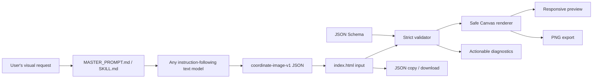

# Coordinate Image Engine

**Open-source text-to-image rendering protocol, AI skill, and testing playground**  
**Protocol identifier:** `coordinate-image-v1`

> **Coordinate Image Engine does not turn a text model into a native neural image-generation model. It provides a structured graphics protocol and renderer that let text models create visual output by generating machine-readable drawing instructions.**

A large language model writes a strict JSON document describing shapes, colors, gradients, text, and layers. A self-contained browser application validates that document and rasterizes it locally with HTML Canvas. There is no image-generation API, no backend, no account, and no mandatory build step.

- Render images for **free, locally, and privately**.
- Use ordinary instruction-following text models from ChatGPT, Gemini, Grok, DeepSeek, OpenRouter-hosted models, or local inference tools.
- Keep the source JSON editable and export a PNG at true document resolution.
- Inspect, validate, and reproduce every drawing instruction.
- Deploy the entire playground as one static `index.html`.

---

## Contents

1. [The problem](#1-the-problem)
2. [How it works](#2-how-it-works)
3. [Architecture](#3-architecture)
4. [Why a text model can do this](#4-why-a-text-model-can-do-this)
5. [Repository structure](#5-repository-structure)
6. [Quick start](#6-quick-start)
7. [Open the testing website](#7-open-the-testing-website)
8. [Use the universal master prompt](#8-use-the-universal-master-prompt)
9. [Install the AI skill](#9-install-the-ai-skill)
10. [Optional `/json-image` command](#10-optional-json-image-command)
11. [Paste, upload, validate, and render](#11-paste-upload-validate-and-render)
12. [Protocol specification overview](#12-protocol-specification-overview)
13. [Example input and output](#13-example-input-and-output)
14. [Visual quality strategy](#14-visual-quality-strategy)
15. [Export and import actions](#15-export-and-import-actions)
16. [Model compatibility](#16-model-compatibility)
17. [Security and privacy](#17-security-and-privacy)
18. [Performance considerations](#18-performance-considerations)
19. [Known limitations](#19-known-limitations)
20. [Automated validation and tests](#20-automated-validation-and-tests)
21. [Troubleshooting](#21-troubleshooting)
22. [Roadmap](#22-roadmap)
23. [Contributing](#23-contributing)
24. [GitHub Pages deployment](#24-github-pages-deployment)
25. [License](#25-license)

---

## 1. The problem

Most image-generation systems are opaque, paid, or tied to a provider API. A user types a prompt, a remote model produces pixels, and the result is difficult to inspect or edit. Meanwhile, many ordinary text models are already good at structured reasoning and JSON generation but cannot directly produce an image file.

Coordinate Image Engine bridges that gap with an open intermediate representation:

```text
Natural-language request → text model → coordinate-image-v1 JSON → local renderer → PNG
```

The output is a **procedural, vector-like drawing**, not a neural image. This is useful for icons, posters, diagrams, stylized artwork, educational graphics, deterministic test assets, and provider-independent experimentation.

## 2. How it works

1. The user gives a model the contents of [`skill/MASTER_PROMPT.md`](skill/MASTER_PROMPT.md).
2. The model enters a persistent Coordinate Image Engine mode and asks one onboarding question if no image has been described.
3. For each visual request, the model returns a complete `coordinate-image-v1` JSON document.
4. The user pastes or uploads that JSON in [`index.html`](index.html).
5. The browser validates the document against the canonical schema and runtime safety limits.
6. A Canvas renderer paints the background and then each element in deterministic array order.
7. The user exports a PNG and can also copy or download the editable JSON.

The renderer is authoritative. It never executes model-provided code and never silently accepts unknown capabilities.

## 3. Architecture



The complete pipeline is local except for the optional model conversation. The renderer does not call a model provider. See [`docs/architecture.md`](docs/architecture.md) for component details and trust boundaries.

## 4. Why a text model can do this

A text model does not need to output pixels to contribute to image creation. It can reason about **composition** and express it as data: a sky rectangle, a sun circle, mountain polygons, a water gradient, reflected ellipses, foreground paths, and a title. The model chooses coordinates, colors, layer order, and typography; Canvas performs the rasterization.

This gives a model a standardized way to describe graphics. It does **not** give the model a native image-generation capability. The model never sees or writes the final PNG, and the renderer never calls the model.

Benefits of the separation:

- JSON is inspectable and editable.
- Output is deterministic for a fixed renderer configuration.
- No API key or remote image service is required.
- The same document can be validated, versioned, diffed, and rendered repeatedly.
- The renderer can enforce safety limits independently of the model.

## 5. Repository structure

```text
coordinate-image-engine/
├── README.md                         This guide
├── LICENSE                           MIT license
├── CONTRIBUTING.md                   Contribution workflow
├── CHANGELOG.md                      Version history
├── index.html                        Complete self-contained playground
├── skill/
│   ├── SKILL.md                      Reusable AI skill specification
│   ├── MASTER_PROMPT.md              Copyable universal model prompt
│   ├── examples/
│   │   ├── simple-landscape.json
│   │   ├── futuristic-robot.json
│   │   ├── abstract-art.json
│   │   ├── app-icon.json
│   │   ├── poster-cover.json
│   │   ├── simple-diagram.json
│   │   └── stylized-architecture.json
│   └── schemas/
│       └── coordinate-image-v1.schema.json
├── docs/
│   ├── architecture.md
│   ├── protocol-specification.md
│   ├── supported-models.md
│   ├── troubleshooting.md
│   └── security.md
├── tests/
│   ├── validate_documents.py         Python schema and negative tests
│   └── runtime-validator.test.mjs    Node runtime/renderer tests
├── tools/
│   └── update-index-assets.py        Optional inline-asset synchronizer
└── .github/
    ├── ISSUE_TEMPLATE/
    │   ├── bug_report.md
    │   └── feature_request.md
    └── workflows/
        └── validate-json.yml
```

The five originally required example categories are present, plus app-icon, poster, diagram, and architecture examples. All are embedded into `index.html` so the playground has no external data dependencies.

## 6. Quick start

### No-build option

1. Download or clone this repository.
2. Open `index.html` in a current desktop or Android browser.
3. A valid example is loaded and rendered automatically.
4. Expand **Model instructions** and copy the master prompt.
5. Paste the prompt into a new model conversation and request an image.
6. Paste the returned JSON into the editor.
7. Choose **Validate JSON**, **Render Image**, and **Export PNG**.

No installation, package manager, environment variable, API key, or server is required for the core app.

### Optional local static server

Some browsers restrict clipboard reading or downloads from `file://`. If so, serve the repository as static files:

```sh
python3 -m http.server 8000
```

Then open `http://localhost:8000/`. This is still a local static file server; it adds no backend behavior.

### Termux / mobile maintainer commands

```sh
pkg install python nodejs git
python3 tools/update-index-assets.py --check
node tests/runtime-validator.test.mjs
python3 -m pip install jsonschema
python3 tests/validate_documents.py
```

The application itself is editable from GitHub's web interface: `index.html`, Markdown files, and JSON examples require no compiler.

## 7. Open the testing website

Open [`index.html`](index.html) directly, or follow [GitHub Pages deployment](#24-github-pages-deployment). The interface provides:

- a prompt and skill-instructions panel;
- an editable JSON paste area;
- local `.json` file upload and optional drag-and-drop;
- schema and runtime validation;
- a seven-document example gallery rendered by the same engine;
- a responsive Canvas preview;
- PNG export at 1× or 2×;
- JSON copy, download, pretty-print, clear, and reset;
- theme toggle and mobile segmented navigation;
- element count, canvas dimensions, gradient count, and complexity status;
- actionable error diagnostics with JSON paths;
- accessible labels, native controls, keyboard shortcuts, and visible focus states.

Keyboard shortcuts in the JSON editor:

- `Ctrl+Enter` / `Cmd+Enter`: validate and render.
- `Ctrl+S` / `Cmd+S`: download canonical JSON.

## 8. Use the universal master prompt

Open [`skill/MASTER_PROMPT.md`](skill/MASTER_PROMPT.md), copy the **entire file**, and paste it as the first instruction in a new chat. Then:

**User**

```text
Activate Coordinate Image Engine.
```

**Assistant**

```text
What kind of image would you like to create? Describe the subject, style, colors, mood, and any important details.
```

**User**

```text
Create a premium futuristic robot with metallic armor, cyan lighting, realistic mechanical details, and a dark sci-fi background.
```

**Assistant**

Returns a complete `coordinate-image-v1` JSON document.

**User, later in the same conversation**

```text
Now create a sunset landscape.
```

**Assistant**

Returns the next complete JSON document without repeating the onboarding question.

The prompt defines a persistent interaction mode. It requires the model to return JSON rather than prose, to use sensible defaults, and to avoid unnecessary follow-up questions.

### Output capability policy

- If the model has a confirmed downloadable-file operation, it may create one `.json` file.
- If file creation is unavailable, uncertain, or unreliable, it must return the whole document in one fenced `json` code block.
- If length is limited, it must simplify the composition rather than truncate JSON.
- It must never claim a file was created or attached without confirmation.
- It must not put explanatory prose inside the JSON.
- It must not require a special API or tool.

A single fenced `json` code block can be pasted directly into the playground.

## 9. Install the AI skill

[`skill/SKILL.md`](skill/SKILL.md) is a self-contained skill specification for compatible AI coding agents and agent environments. It explains activation, composition planning, protocol rules, validation, repair, and output modes.

Do **not** assume every AI product supports `SKILL.md`. Depending on the environment:

- install it through that agent's documented skill mechanism;
- upload the file and instruct the agent to follow it;
- paste its contents into system instructions or persistent custom instructions;
- use [`MASTER_PROMPT.md`](skill/MASTER_PROMPT.md) in an ordinary chat;
- register a command alias such as `/json-image` where the environment supports custom commands.

The skill is provider-independent and contains no API keys or proprietary calls.

## 10. Optional `/json-image` command

`/json-image` is an **optional convenience**, not a universal chat feature. Writing the command into this README does not register it with ChatGPT, Gemini, Grok, DeepSeek, or every OpenRouter model.

Available approaches:

1. **Compatible agent environment:** install `SKILL.md` and register `/json-image` as a command or alias using that environment's documentation.
2. **Uploaded instructions:** provide `SKILL.md` to the agent and refer to it when invoking the command.
3. **Ordinary chat:** paste `MASTER_PROMPT.md` once into a new conversation and continue in that same conversation.
4. **Future independent chats:** paste the prompt again, or use that product's supported persistent-instruction feature.

The protocol works with plain text generation; no slash command is required.

## 11. Paste, upload, validate, and render

### Mode A — upload a JSON file

Choose **Choose JSON file** or drop a `.json` file on the editor. The browser reads the file locally, parses and validates it, pretty-prints the parsed document in the editor, and enables rendering when validation succeeds.

### Mode B — paste JSON

Paste a complete document or a single fenced `json` code block into the clearly labeled editor. Choose **Validate JSON** to see precise diagnostics, then **Render Image**. The **Paste JSON** button can read the system clipboard where browser permission allows; normal keyboard or long-press paste always works in the editor.

Additional real actions:

- **Copy JSON** — copies editor text with a selection fallback.
- **Download JSON** — downloads canonical pretty-printed JSON using a title-based safe filename.
- **Pretty-print** — formats the parsed JSON.
- **Load an example** — replaces the editor with a valid embedded document and renders it.
- **Clear editor** — empties the editor and preview.
- **Reset example** — restores a valid default example.
- **Export PNG** — re-renders the validated document into an offscreen Canvas and downloads a PNG.

All processing is local. The app never uploads an imported file.

## 12. Protocol specification overview

A document is a strict JSON object:

```json
{
  "protocol": "coordinate-image-v1",
  "canvas": { "width": 768, "height": 768, "background": "#101820" },
  "metadata": { "title": "Example", "description": "A short description" },
  "gradients": {},
  "elements": []
}
```

- Required root fields: `protocol`, `canvas`, `elements`.
- Optional root fields: `metadata`, `gradients`.
- Coordinates are logical pixels from the top-left corner.
- Elements are drawn in array order; there is no z-index.
- Colors use `#RGB`, `#RRGGBB`, or `#RRGGBBAA` hex format.
- Paints may also reference named linear or radial gradients.
- Supported types: `rectangle`, `rounded-rectangle`, `circle`, `ellipse`, `line`, `polyline`, `polygon`, `path`, `text`, and `group`.
- Common style: fill, stroke, stroke width, opacity, line caps/joins, dashes, shadows, and transforms.
- Paths use a restricted `M L H V C Q Z` grammar, never arbitrary SVG markup.
- Text uses generic fonts, explicit size/weight/alignment/baseline, optional stroke, and `\n` line breaks.
- Groups safely compose transforms and opacity.
- Unknown properties, unsupported types, non-finite numbers, dangling gradient references, duplicate ids, excessive complexity, and oversized values are rejected.

The authoritative contract is [`skill/schemas/coordinate-image-v1.schema.json`](skill/schemas/coordinate-image-v1.schema.json) and [`docs/protocol-specification.md`](docs/protocol-specification.md). The browser embeds the same schema and adds cross-field runtime checks.

## 13. Example input and output

A compact valid input:

```json
{
  "protocol": "coordinate-image-v1",
  "canvas": { "width": 640, "height": 360, "background": "#101820" },
  "metadata": { "title": "Evening Signal" },
  "elements": [
    {
      "id": "glow",
      "type": "circle",
      "x": 320,
      "y": 170,
      "radius": 110,
      "fill": "#65D9FF",
      "opacity": 0.2
    },
    {
      "id": "sun",
      "type": "circle",
      "x": 320,
      "y": 170,
      "radius": 54,
      "fill": "#FFD166"
    },
    {
      "id": "horizon",
      "type": "line",
      "x1": 40,
      "y1": 250,
      "x2": 600,
      "y2": 250,
      "stroke": "#C6CDD5",
      "strokeWidth": 2,
      "opacity": 0.7
    }
  ]
}
```

The output is a 640×360 PNG with a dark background, a soft cyan glow, a gold circle, and a muted horizon. The exact bitmap is generated by the local renderer, not by the model. The JSON remains available for editing and download.

For richer references, open the example gallery or read:

- [`simple-landscape.json`](skill/examples/simple-landscape.json)
- [`futuristic-robot.json`](skill/examples/futuristic-robot.json)
- [`abstract-art.json`](skill/examples/abstract-art.json)
- [`app-icon.json`](skill/examples/app-icon.json)
- [`poster-cover.json`](skill/examples/poster-cover.json)
- [`simple-diagram.json`](skill/examples/simple-diagram.json)
- [`stylized-architecture.json`](skill/examples/stylized-architecture.json)

## 14. Visual quality strategy

The protocol is capable of more than flat geometric icons. A model can build richer artwork by combining:

- a background gradient and atmospheric radial glows;
- distant silhouettes with lower contrast and opacity;
- a dominant focal shape with carefully placed highlights;
- linear metal or sky gradients and radial light cores;
- repeated small details for texture, windows, joints, stars, or reflections;
- polygons and restricted paths for organic contours;
- shadows and offset highlights for depth;
- typography with deliberate hierarchy and spacing;
- groups and transforms for repeated local structures.

The seven shipped examples cover landscapes, futuristic robots, abstract art, app icons, posters and cover artwork, simple diagrams, and stylized architecture.

This is **procedural, vector-like graphics generation**. It can approximate atmosphere and material using layered shapes and gradients, but it cannot promise photorealistic quality, learned texture synthesis, or faithful reproduction of arbitrary complex scenes. Use a dedicated image model when that is genuinely required.

## 15. Export and import actions

| Action | Result |
|---|---|
| Export PNG | Re-renders the validated document at 1× or 2× and downloads a PNG. |
| Download JSON | Downloads canonical pretty-printed JSON with a title-based filename. |
| Copy JSON | Copies the editor text where clipboard permission allows. |
| Import JSON file | Reads a local `.json` file, displays parsed JSON, validates it, and renders it. |
| Reset | Restores a valid example. |
| Paste JSON | Reads the clipboard on explicit user action where supported. |
| Drag-and-drop | Imports a dropped local file or plain JSON text where supported. |

Filenames are normalized to a safe ASCII slug based on `metadata.title`, with `coordinate-image` as a fallback. Browser limitations are reported rather than silently ignored.

## 16. Model compatibility

The protocol minimizes reliance on proprietary capabilities: plain text generation is enough. It should work with many instruction-following models, including free-access interfaces from providers such as Gemini, Grok, DeepSeek, OpenRouter-hosted models, and local models. ChatGPT and other chat products can also use the prompt.

Results depend on:

- instruction following across multiple turns;
- context window size;
- JSON reliability;
- output token limits;
- sampling settings;
- rate limits;
- availability of a provider's free web tier or free API quota.

Free model access, free API quotas, and completely local inference are different things. A free chat interface still sends the prompt to a provider; a local model keeps it on your hardware. See [`docs/supported-models.md`](docs/supported-models.md) for a compatibility matrix and smoke test.

The core renderer remains free and usable independently of any model provider. No API keys are embedded or required.

## 17. Security and privacy

- Local-first processing: JSON and images remain in the browser tab.
- No telemetry, analytics, hidden uploads, or external API calls in the core renderer.
- No external assets, fonts, scripts, or styles.
- Strict JSON parsing and schema validation.
- No `eval`, `new Function`, arbitrary HTML, event handlers, or arbitrary SVG injection.
- Restricted path grammar parsed into Canvas operations.
- Safe DOM text APIs for all model-controlled strings and diagnostics.
- Bounded canvas area, element count, nesting, path complexity, text length, and total complexity.
- A restrictive meta Content Security Policy with `connect-src 'none'`.
- Only a theme preference is stored in `localStorage`.

The app does not interpret imported JSON as executable code. See [`docs/security.md`](docs/security.md) for the threat model, residual risks, and vulnerability reporting guidance.

## 18. Performance considerations

- Validation runs before drawing and uses a combined complexity budget.
- The preview is rendered once at logical document dimensions; CSS handles responsiveness.
- PNG export re-renders offscreen rather than upscaling the preview bitmap.
- 2× export is limited to 8192 pixels per side and 16,000,000 pixels total.
- There are no animation loops, workers, heavy libraries, or network waits.
- Generic fonts and Canvas antialiasing can vary by device, affecting exact pixel output.
- Very large JSON or thousands of elements can make mobile browsers slow even when technically within limits. Prefer 20–120 well-planned elements for model-generated art.

## 19. Known limitations

- This is not neural image generation and cannot produce guaranteed photorealism.
- The model must follow JSON instructions; small models may invent properties or truncate output.
- Generic fonts are not pixel-identical across operating systems.
- The protocol has no clipping paths, bitmap images, blend modes, filters, embedded fonts, or perspective transforms.
- Path support is intentionally limited to a safe SVG subset; arcs and smooth shorthands are unavailable.
- Geometry outside the canvas is clipped, not automatically fitted.
- `JSON.parse` uses normal last-value-wins behavior for duplicate object keys; authors should avoid duplicate keys.
- Clipboard read/write can be blocked on `file://` or in sandboxed iframes.
- 2× PNG export may be rejected for large canvases to avoid memory exhaustion.
- The app is one file by design, so its embedded schema and examples must be synchronized with an optional maintainer script after source edits.
- Provider free tiers and API quotas can change; this project does not guarantee them.

## 20. Automated validation and tests

The GitHub Actions workflow [`.github/workflows/validate-json.yml`](.github/workflows/validate-json.yml) runs on pushes, pull requests, and manual dispatch. It:

1. checks that inline schema/examples/prompt match source files;
2. installs the free Python `jsonschema` package;
3. validates the schema itself and every example;
4. checks positive and negative cases: missing fields, unsupported types, invalid colors, out-of-range dimensions, excessive element counts, malformed JSON, gradient references, path grammar, and resource limits;
5. runs the dependency-free Node runtime/renderer test against the actual inline application code.

Local commands:

```sh
python3 tools/update-index-assets.py --check
python3 tests/check_markdown_links.py
python3 -m pip install jsonschema
python3 tests/validate_documents.py
node tests/runtime-validator.test.mjs
```

The app itself needs none of these tools to run.

## 21. Troubleshooting

Common issues and fixes:

- **Invalid JSON:** remove prose, comments, trailing commas, and unbalanced Markdown fences.
- **Unsupported property/type:** compare the element with [`docs/protocol-specification.md`](docs/protocol-specification.md).
- **Invalid color:** use `#RGB`, `#RRGGBB`, or `#RRGGBBAA`; CSS names are rejected.
- **Undefined gradient:** define the named gradient in top-level `gradients`.
- **Blank image:** check `fill`, `stroke`, `opacity`, `visible`, and coordinates.
- **Path error:** add an explicit command letter to every segment; arcs are unsupported.
- **Clipboard blocked:** use normal paste/copy gestures or a local static server.
- **2× export fails:** choose 1× or reduce canvas dimensions.
- **GitHub Pages link downloads Markdown:** open the documentation from the GitHub repository instead.
- **Model returns prose:** start a fresh chat and paste the master prompt first.

See [`docs/troubleshooting.md`](docs/troubleshooting.md) for a complete diagnostic table.

## 22. Roadmap

Potential future additions, without changing v1 rendering semantics:

- optional SVG export from the same validated document;
- clipboard-based screenshot comparison tests;
- a command-line renderer that shares the schema and semantics;
- more example packs for charts, maps, characters, and UI mockups;
- optional accessibility metadata for long artwork descriptions;
- a schema-driven visual editor for individual coordinates;
- a conformance suite with golden PNG hashes per browser engine;
- additional translations of the master prompt.

Any protocol addition that changes existing rendering behavior will use a new protocol identifier.

## 23. Contributing

Contributions are welcome through GitHub's web interface, a desktop clone, or Termux. Please read [`CONTRIBUTING.md`](CONTRIBUTING.md) before opening a pull request.

Typical contributions:

- new valid example documents;
- clearer validation diagnostics;
- documentation fixes and translations;
- additional model smoke tests;
- renderer performance and accessibility improvements;
- negative tests for unsafe JSON.

When changing the protocol, update the schema, runtime validator, renderer, docs, prompt, skill, examples, tests, and changelog together. Use the existing bug report and feature request templates.

## 24. GitHub Pages deployment

1. Push this repository to GitHub.
2. Open **Settings → Pages**.
3. Under **Build and deployment**, choose **Deploy from a branch**.
4. Select your publishing branch and the **/ (root)** folder.
5. Save. GitHub Pages serves `index.html` at the repository site URL.

No build command, Jekyll step, secret, or environment variable is needed. To avoid Jekyll processing, you may optionally add an empty `.nojekyll` file, but the app does not depend on it.

Pages must be enabled once by a repository administrator. An automated deployment workflow cannot create the Pages site when the connected app or workflow token lacks Pages permission; in that case GitHub returns "Resource not accessible by integration" and the manual toggle above is the only supported path.

The same `index.html` works from a local `file://` URL, a simple static server, or GitHub Pages. Clipboard and download permissions are most predictable over HTTPS or `localhost`.

## 25. License

Released under the [MIT License](LICENSE). Copyright © 2026 Coordinate Image Engine contributors.

The protocol, documentation, examples, and renderer are free software. Text-model providers have their own independent terms, rate limits, and privacy policies; Coordinate Image Engine does not grant access to those services and is not affiliated with them.
