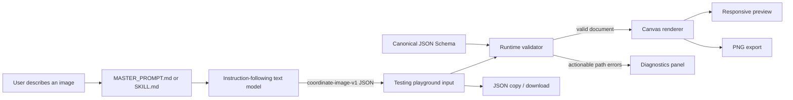
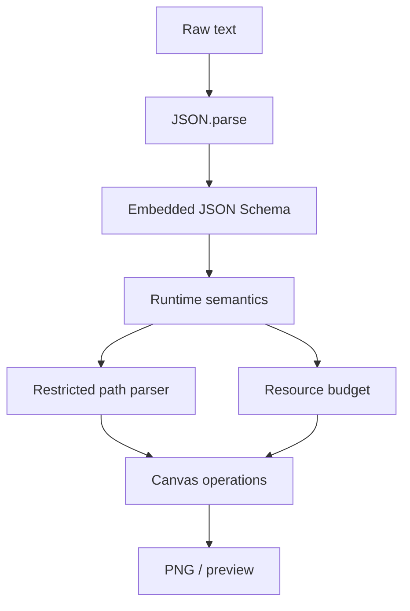

# Architecture

Coordinate Image Engine separates **authoring** from **drawing**. A text model writes a declarative JSON document; a local browser program validates and paints it. There is no backend, inference endpoint, image API, telemetry service, or build-time code generation in the runtime path.

## System diagram

The dashed trust boundary is the browser. JSON may originate from any untrusted model, file, or clipboard, so it crosses that boundary as **data only**.

## Repository components

| Component | Responsibility |
|---|---|
| `skill/MASTER_PROMPT.md` | Provider-independent persistent prompt for ordinary text models. |
| `skill/SKILL.md` | Reusable skill instructions for compatible agent environments. |
| `skill/schemas/coordinate-image-v1.schema.json` | Canonical strict Draft 2020-12 schema. |
| `skill/examples/*.json` | Reference documents covering landscapes, robots, abstract art, icons, posters, diagrams, and architecture. |
| `index.html` | Entire user-facing application: HTML, CSS, embedded schema/examples/prompt, validator, renderer, and UI. |
| `tools/update-index-assets.py` | Optional maintainer tool that synchronizes inline assets from the source files. |
| `tests/validate_documents.py` | CI schema and negative-case checks with Python `jsonschema`. |
| `tests/runtime-validator.test.mjs` | Node checks of the actual inline validator/renderer using a fake Canvas context. |
| `.github/workflows/validate-json.yml` | Push/PR validation with no application dependencies. |

## Runtime pipeline

1. **Input** — A user uploads a `.json` file, drops one on the editor, pastes JSON, loads an embedded example, or reads JSON from the clipboard. A single fenced `json` code block is also accepted.
2. **Parse** — The browser uses `JSON.parse` only. Comments, trailing commas, executable expressions, and non-object roots are rejected. Input is limited to 512 KiB.
3. **Schema validation** — The embedded copy of the canonical schema checks protocol id, exact object shapes, required fields, types, enums, numeric bounds, patterns, array sizes, and unknown properties.
4. **Semantic validation** — Cross-field rules check canvas area, gradient references, unique ids, group depth, recursive element count, path grammar, text line count, and the complexity budget.
5. **Render** — A fresh Canvas transform is established. The background is painted, then elements are traversed in array order. Groups compose transforms and multiply opacity. Each primitive builds a Canvas path from numeric values.
6. **Preview** — The resulting bitmap has the document's logical dimensions. CSS scales it for the screen; no geometry is recalculated for the preview size.
7. **Export** — PNG export re-renders into an offscreen Canvas at 1× or 2× from the same validated document. JSON export preserves the parsed document as pretty-printed text.
8. **Errors** — Parsing, validation, rendering, and browser-capability failures are reported through DOM text APIs. Rendering is skipped if validation fails.

## Why this is not native image generation

A diffusion model learns a mapping from text or noise to a pixel grid. A language model using this protocol emits **structured drawing data**. It chooses primitives, colors, coordinates, and layer order; the renderer performs rasterization. This makes output inspectable, editable, reproducible, and free to render locally, but it cannot magically provide photorealistic texture synthesis or learned visual priors.

The renderer is the authority. A model cannot ask it to run JavaScript, fetch remote assets, create arbitrary SVG, or bypass the schema. If a document uses unsupported capabilities, the renderer reports an error rather than guessing.

## Validation layers

The CI workflow independently validates example files with the full Python `jsonschema` implementation. The browser uses a small, dependency-free evaluator for the schema keywords this project uses, plus the same documented semantic checks. This keeps `index.html` self-contained while maintaining one canonical schema.

## Determinism

The renderer does not use randomness, animation clocks, device pixel ratio, network state, or persistent application state. The same validated document and scale produce the same sequence of Canvas operations. Exact output pixels can still differ across browser engines because of antialiasing, shadows, and generic font rasterization.

## Performance design

- Validation happens before any expensive drawing.
- Canvas dimensions, area, element count, path commands, text length, group depth, and a combined complexity budget are bounded.
- Rendering is synchronous and finite; there are no request loops or workers.
- CSS handles responsiveness, so window resizing does not re-render the bitmap.
- All examples are deliberately modest in size to remain usable on Android devices.
- PNG export uses an offscreen canvas and rejects oversized 2× exports.

## Extension guidelines

A new primitive or style should update all of these in the same change:

1. `docs/protocol-specification.md`;
2. the canonical JSON Schema;
3. the runtime renderer and any semantic checks;
4. the master prompt and skill cheat sheet;
5. positive and negative tests;
6. at least one example if the capability affects visual quality;
7. the changelog and README compatibility notes.

Do not add external fonts, remote images, arbitrary markup, provider-specific fields, or executable callbacks. If a change alters how existing valid documents render, create a new protocol identifier instead.
